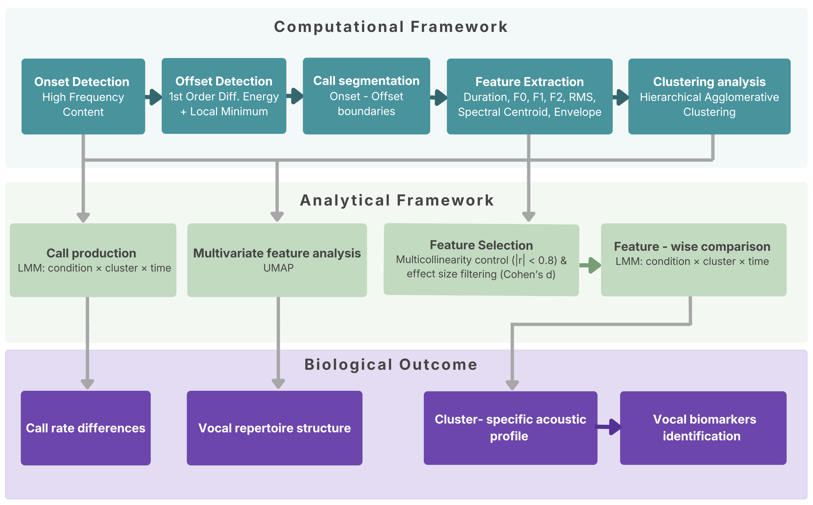

# Computational and Analytical Framework for Chick Vocalisation Analysis

Code for: Torrisi, A.M.C., Nolasco, I., Sgadò, P., Versace, E., & Benetos, E. (2026). *Embryonic Exposure to VPA Influences Chick Vocalisations: A Computational Study*.

[arXiv preprint](https://arxiv.org/abs/2601.12203) · [Dataset on Zenodo](https://doi.org/10.5281/zenodo.19468051)

## Overview

This repository contains the code for the automated analysis of the vocal repertoire of the domestic chick (*Gallus gallus*). It is organised into two main components:

The **Computational Framework** (Python) is the analysis pipeline. It performs automated detection of vocalisation onsets and offsets, extraction of 20 acoustic features from the temporal, frequency, and energy domains, UMAP visualisation, and unsupervised clustering through Hierarchical Agglomerative Clustering (HAC).

The **Analytical Framework** (R) is the statistical model used to compare acoustic features between distinct experimental groups. It uses Linear Mixed-Effects Models (LMMs) with condition, cluster, and time as fixed effects, and chick identity as a random intercept. It also contains the visualisation scripts that produce the feature plots and multi-panel figures reported in the paper.

## Pipeline

The pipeline takes normalised WAV files as input and produces:
- onset and offset timestamps for each detected call
- 20 acoustic features per call (temporal, frequency, and energy domains)
- unsupervised cluster assignments (no predefined call categories needed)
- statistical comparisons between experimental groups

We developed this pipeline (the **Computational Framework**) on a sample of untreated newly-hatched chicks, combining automated call detection, multi-feature acoustic analysis across temporal, frequency, and energy domains, and unsupervised clustering with the number of vocal categories selected via grid search over internal validity metrics (Silhouette Score, Calinski-Harabasz Index, WCSS). We then tested its generalisability on an independent dataset of VPA-exposed and control chicks (46 recordings), comparing the two groups via linear mixed-effects models (with the **Analytical Framework**). The framework revealed systematic, call-type-specific differences between groups.



## Detection performance

The onset and offset detection methods were first tested on the development dataset (31 chicks) and then validated as a benchmark on the independent experimental dataset (46 chicks: 27 VPA, 19 control). Performance was evaluated against manual annotations using event-based metrics (Mesaros et al., 2016).

| Dataset | Detection | Weighted F1 | Precision | Recall |
|---------|-----------|-------------|-----------|--------|
| Development (31 chicks) | Onset (HFC) | 0.853 | 0.908 | 0.841 |
| Development (31 chicks) | Offset (energy 1st-order diff + local min) | 0.724 | 0.724 | 0.724 |
| Experimental (46 chicks) | Onset (HFC) | 0.933 | 0.910 | 0.961 |
| Experimental (46 chicks) | Offset (energy 1st-order diff + local min) | 0.885 | 0.885 | 0.885 |

HFC = High Frequency Content algorithm. The offset method computes the first-order difference of the energy signal starting from the predicted onset, then detects the local minimum within a time window set by the maximum expected call duration.

## Requirements

**Python 3.9+**

```bash
pip install numpy pandas librosa scipy scikit-learn umap-learn matplotlib seaborn soundfile tqdm ffmpeg-python
```

The video-to-audio script also requires `ffmpeg` to be installed on the system (e.g. `brew install ffmpeg` on macOS, or download from ffmpeg.org for Windows).

**R 4.3+**

```r
install.packages(c("lme4", "lmerTest", "emmeans", "effectsize", "dplyr", "readr", "broom.mixed", "car", "ggplot2", "knitr"))
```

## Repository structure

```
├── preprocessing_video_to_audio.py             # Step 0a: extract audio from video files (mp4/MTS) to WAV
├── preprocessing_stereo_to_mono.py             # Step 0b: convert multichannel WAV to mono
├── preprocessing_loudness_normalisation.py     # Step 0c: max-amplitude loudness normalisation of WAV files
│
├── Computational_Framework/
│   │
│   │  # Step 1: Call detection
│   ├── Automatic_onsets_offsets_detection.py    # main script: runs onset + offset detection
│   ├── onset_detection_algorithms.py           # HFC and alternative onset methods
│   ├── offset_detection.py                     # offset detection (1st/2nd order energy diff)
│   ├── onsets_offsets_detection_utils.py        # shared detection utilities
│   │
│   │  # Step 2: Feature extraction
│   ├── Main_Feature_Extraction.py              # main script: extracts 20 features per call
│   ├── feature_extraction_functions.py         # F0, RMS, spectral centroid, envelope functions
│   ├── update_features_csv.py                  # adds metadata (recording ID, call ID) to CSVs
│   │
│   │  # Step 3: Clustering
│   ├── hierarchical_clustering_search_params.py  # Step 3a: grid search to find the optimal K using internal cluster validity metrics (Silhouette, CHI, WCSS)
│   ├── Hierarchical_clustering_analysis.py     # Step 3b: applies HAC with chosen K + UMAP + spectrograms
│   ├── clustering_utils.py                     # dendrogram, UMAP, radar plots, sampling
│   ├── gmm_clustering_search_params.py         # grid search over K (GMM, for comparison)
│   ├── identikit_bioacoustic.py                # spectrogram generator for cluster inspection
│   │
│   │  # Utilities
│   ├── visualisation_features.py               # feature-level plots (spectrograms + overlays)
│   ├── visualization.py                        # general plotting
│   ├── utils.py                                # I/O, filtering noise, shared helpers
│   ├── save_results.py                         # export to CSV (Sonic Visualiser compatible)
│   └── joint_time_frequency_scattering_coefficients.py  # experimental (not used in paper)
│
├── Analytical_Framework/
│   ├── Analyses_features/
│   │   ├── Full_analyses_features_vpa_study.R            # LMM model fitting (all 20 features)
│   │   ├── Lmm_acoustic_features_compute_partial_eta_squared.R  # model selection (LRT + AIC), LRTs on the full model,  FDR, partial eta-squared.
│   │   ├── Statistical_analyses_2_clusters_with_post_tukey.R  # post-hoc pairwise comparisons
│   │   ├── Analysis_Call_duration.R                      # per-feature scripts (one each):
│   │   ├── Analysis_F0_std.R                             #   Call Duration, F0 Std, RMS Mean,
│   │   ├── Analysis_RMS_Mean.R                           #   Attack Magnitude, F0 Slope, etc.
│   │   ├── ...                                           #
│   │   └── Visualisation/
│   │       ├── Features_plots.R                          # condition x cluster x time plots
│   │       ├── Features_multiplots.R                     # multi-panel figures (Figs 6-9)
│   │       └── Plot_extractions_features_clusters_2_3.R  # cluster comparison plots
│   ├── Calls_frequency_analysis/
│   │   ├── Analysis_number_distribution_ribbon.R         # call rate LMM
│   │   ├── Lmm_number_of_calls_partial_eta_squared_analysis.R  # number of calls LMM, model selection, LRTs, partial eta-squared, post-hoc
│   │   └── Number_calls_lmm_plots.R                     # call rate plots
│   └── Multicollinearity/
│       └── Multicollinearity_analysis.R                  # VIF, pairwise correlations, feature selection
│
└── pipeline_overview.png
```

## How to use

The pipeline runs in sequential steps. Each step reads the output of the previous one.

**Input format:** mono WAV files, 44.1 kHz. If your starting point is a video file or a multichannel WAV, use the pre-processing scripts in Step 0 first.

### Step 0. Pre-processing

If you are starting from video recordings or stereo audio, run the pre-processing scripts in order. If your input is already mono WAV, you only need Step 0c.

**Step 0a. Extract audio from video files (optional, only if starting from video)**

```bash
python preprocessing_video_to_audio.py
```

Uses ffmpeg to extract the audio track from each video file (`.mp4`, `.MTS`) in the input folder, and saves it as a mono WAV at 44.1 kHz. Multichannel audio is averaged across channels. Set `input_directory` and `output_directory` at the top of the script.

**Step 0b. Stereo to mono conversion (optional, only if your WAVs are multichannel)**

```bash
python preprocessing_stereo_to_mono.py
```

Converts multichannel WAV files to mono by averaging across all channels (same approach as Audacity's "Stereo Track to Mono"). Set `input_folder` and `output_folder` at the top of the script. A commented block at the top of the loop can be enabled to save per-channel spectrograms as PNGs for visual quality control.

**Step 0c. Loudness normalisation**

```bash
python preprocessing_loudness_normalisation.py
```

Applies max-amplitude normalisation to all mono WAV files in the input folder. Set `input_folder` and `output_folder` at the top of the script.

**Output:** normalised mono WAV files ready for the next steps.

### Step 1. Detect calls

```bash
python Computational_Framework/Automatic_onsets_offsets_detection.py
```

Set `audio_folder` at the top of the script to point to your normalised WAV files.

The script uses the **High Frequency Content (HFC)** algorithm for **onset detection**. For **offset detection**, starting from each predicted onset, it computes the first-order difference of the energy signal and then locates the local minimum within a time window defined by the maximum expected call duration. The detection parameters (`HFC_parameters` dict) are tuned for chick vocalisations.

**Output:** one CSV per recording with `onset_time` and `offset_time` columns (seconds).

### Step 2. Extract features

```bash
python Computational_Framework/Main_Feature_Extraction.py
```

Set the paths to your audio folder and the onset/offset CSVs from Step 1.

A bandpass filter is applied first (default: 2000 to 15,000 Hz). Then, for each call segment, 20 acoustic features are extracted:

| Domain | Features |
|--------|----------|
| Temporal | Call Duration, Attack Time, Envelope Slope |
| Frequency | F0 Mean, F0 Std, F0 Kurtosis, F0 Skewness, F0 Bandwidth, F0 Slope, F0 1st Order Diff, F0 Mag Mean, F1 Mag Mean, F2 Mag Mean, F1/F0 Ratio Mean, F2/F0 Ratio Mean, Spectral Centroid Mean, Spectral Centroid Std, Attack Magnitude |
| Energy | RMS Mean, RMS Std |

F0 is estimated via the pYIN algorithm. Harmonics (F1, F2) are derived from FFT. The signal envelope is computed via Hilbert transform. See `feature_extraction_functions.py` for the implementation of each feature.

**Output:** CSV with 20 features per call, plus recording and call IDs.

### Step 3a. Determine the optimal number of clusters (grid search)

Before clustering, run the grid search to identify the optimal number of clusters for your data.

```bash
python Computational_Framework/hierarchical_clustering_search_params.py
```

Set `features_path`, `audio_path`, `metadata_path`, and `clusterings_results_path` at the top of the script. The grid search evaluates K = 2 to 10 using Silhouette Score, Calinski-Harabasz Index, and WCSS (elbow method).

**Output:** evaluation metric plots and a summary identifying the optimal K.

### Step 3b. Cluster calls

Once the optimal K has been identified, run the clustering analysis:

```bash
python Computational_Framework/Hierarchical_clustering_analysis.py
```

Set `n_clusters` inside the script to the value chosen from Step 3a (default: 2). Features are z-score normalised and clustered using Hierarchical Agglomerative Clustering (Ward linkage, via `sklearn.cluster.AgglomerativeClustering`). The script produces dendrograms, 2D and 3D UMAP projections, and spectrograms of representative calls at varying distances from cluster centroids.

**Output:** feature CSV with cluster labels added, dendrogram plots, UMAP plots, spectrogram panels, statistical reports.

### Step 4. Statistical comparison between groups (R)

The Analytical Framework provides the statistical model for comparing acoustic features between distinct experimental groups. Set the working directory to `Analytical_Framework/` and run:

```r
# Main feature analysis: LMMs with condition x cluster x time_bin
source("Analyses_features/Full_analyses_features_vpa_study.R")

# Post-hoc Tukey comparisons
source("Analyses_features/Statistical_analyses_2_clusters_with_post_tukey.R")

# Call rate analysis
source("Calls_frequency_analysis/Analysis_number_distribution_ribbon.R")

# Multicollinearity checks and feature selection
source("Multicollinearity/Multicollinearity_analysis.R")
```

The LMMs use condition, cluster, and time bin as fixed effects and chick ID as a random intercept. Model selection is done via AIC-based progressive simplification, with FDR correction for multiple comparisons.

Individual feature scripts (`Analysis_Call_duration.R`, `Analysis_F0_std.R`, etc.) can be run independently for specific features. Visualisation scripts in `Analyses_features/Visualisation/` reproduce the feature plots reported in the paper.

## Adapting to other recordings

The main parameters to adjust:

| Parameter | File | Default | When to change |
|-----------|------|---------|----------------|
| `audio_folder` | `Automatic_onsets_offsets_detection.py` | hardcoded path | always (set to your data) |
| BPF range | `Main_Feature_Extraction.py` | 2000 to 15,000 Hz | if your species has a different frequency range |
| HFC parameters | `Automatic_onsets_offsets_detection.py` | tuned for chick calls | if detection performance is poor |
| `n_clusters` | `Hierarchical_clustering_analysis.py` | 2 | run grid search first to find the optimal cluster division |

The pipeline was tested on two independently collected datasets with different recording setups (different arenas, durations, and chick ages) and recovered consistent results in both cases.

## Data

Full datasets available on Zenodo: [https://doi.org/10.5281/zenodo.19468051](https://doi.org/10.5281/zenodo.19468051)

## Citation

```bibtex
@article{torrisi2026vpa,
  title={Embryonic Exposure to {VPA} Influences Chick Vocalisations: A Computational Study},
  author={Torrisi, Antonella M. C. and Nolasco, In\^{e}s and Sgad\`{o}, Paola
          and Versace, Elisabetta and Benetos, Emmanouil},
  journal={arXiv preprint arXiv:2601.12203},
  year={2026},
  url={https://arxiv.org/abs/2601.12203}
}
```

## Licence

This work is licensed under [CC BY 4.0](http://creativecommons.org/licenses/by/4.0/).

## Contact

Antonella M. C. Torrisi  
a.m.c.torrisi@qmul.ac.uk | antonellatorr91@gmail.com  
Centre for Digital Music, Queen Mary University of London